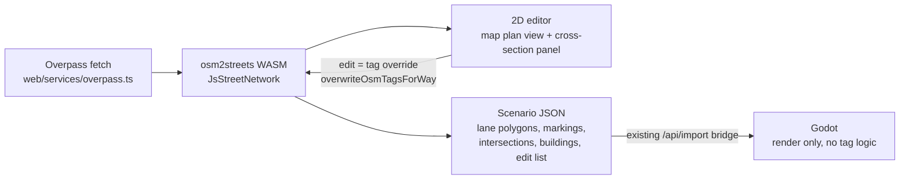

# 2D Street Editor Plan

Goal: **OSM import → 2D street editor → 3D visualization in Godot.** Planners load real streets, see buildings, roads, sidewalks and lane widths in plan view, propose changes (e.g. take a travel lane for a bike lane), and view the result in 3D.

## Existing tools

No free tool covers all three steps: load OSM, edit lanes in plan view with real widths, then export a model a custom 3D engine can use. Several tools cover part of it:

| Tool                                                                                                                                     | What it does                                                                                                                               | Why it doesn't fit                                                                                                                            |
| ---------------------------------------------------------------------------------------------------------------------------------------- | ------------------------------------------------------------------------------------------------------------------------------------------ | --------------------------------------------------------------------------------------------------------------------------------------------- |
| **osm2streets / Street Explorer** ([repo](https://github.com/a-b-street/osm2streets), [demo](https://a-b-street.github.io/osm2streets/)) | Turns OSM into lane-level geometry: lane polygons, markings, intersection shapes, inferred sidewalks. Has a basic lane editor. Apache-2.0. | A library and debug viewer, not a planner's editor. But it is the right engine to build on (see below).                                       |
| **A/B Street** ([docs](https://a-b-street.github.io/docs/software/abstreet.html))                                                        | Plan-view lane editor with traffic simulation. Can turn parking into a bike or bus lane.                                                   | Closed Rust app. Can't export a scene to another 3D engine. Its geometry code became osm2streets.                                             |
| **3DStreet** ([repo](https://github.com/3DStreet/3dstreet))                                                                              | Streetmix cross-sections → 3D in the browser. Recently added "click an OSM way → Generate Street" with curved paths and intersections.     | 3D-first, not a 2D editor. Own three.js/A-Frame renderer. AGPL code, non-commercial assets. Closest in spirit; a competitor, not a component. |
| **Streetmix / StreetPlan**                                                                                                               | Cross-section editing.                                                                                                                     | One slice only, no network or map.                                                                                                            |
| **Remix Streets (Via), ArcGIS CityEngine, MathWorks RoadRunner, SUMO netedit**                                                           | Plan-view lane editing; CityEngine/RoadRunner also export 3D.                                                                              | Commercial or heavy engineering tools (netedit is a traffic-sim editor). Current features not verified.                                       |

**Conclusion:** build the editor. Don't write our own OSM-to-lane geometry. Use osm2streets compiled to WASM as the street engine, and spend effort on the editor and the Godot renderer.

## Proposed pipeline

Core idea: **an edit is a change to the OSM tags on a way.** "Take a lane for a bike lane" means setting `lanes=4→3` and adding `cycleway:right=lane`. osm2streets then recomputes lanes, widths and intersection shapes. osm2streets-js already exposes `overwriteOsmTagsForWay`, plus `toLanePolygonsGeojson`, `toLaneMarkingsGeojson` and `toIntersectionMarkingsGeojson` ([lib.rs](https://github.com/a-b-street/osm2streets/blob/main/osm2streets-js/src/lib.rs)).

Because edits are stored as differences from the OSM baseline:

- before/after comparison is easy;
- OSM can be re-downloaded and the edits replayed;
- each proposal is a small edit list that can be saved and shared.

Not expressible as tags: freeform shapes like curb extensions, plazas, or moving a curb line. Handle those later with a separate geometry-override layer, not in the first version.

## How the stack changes

| Area                        | Now                                                                                                                                           | After                                                                                                                                                                                                                                               |
| --------------------------- | --------------------------------------------------------------------------------------------------------------------------------------------- | --------------------------------------------------------------------------------------------------------------------------------------------------------------------------------------------------------------------------------------------------- |
| **Role of `web/`**          | Bounding-box downloader                                                                                                                       | The main app: import, edit, save scenarios                                                                                                                                                                                                          |
| **Web deps**                | Vue, MapLibre                                                                                                                                 | + osm2streets-js (WASM), + Pinia for scenario and undo state. MapLibre stays as the plan view (GeoJSON fill/line layers for lanes; custom click and handle logic). Add a Streetmix-style SVG cross-section panel for the selected road.             |
| **Toolchain**               | Bun, Godot                                                                                                                                    | + Rust and `wasm-pack` in `mise.toml`, probably. The npm `osm2streets-js` is at 0.1.4 and `toJson()` documents "no guarantees about backwards compatibility". Plan to pin a commit and build it ourselves (package staleness inferred, not tested). |
| **Data contract**           | Raw Overpass JSON → Godot                                                                                                                     | A versioned **scenario JSON**: OSM baseline, edit list, and derived lane/intersection geometry plus buildings. The one interface between web and Godot.                                                                                             |
| **Godot `road_builder.gd`** | Reads tags: `resolve_road_width`, `parse_bike_lanes`, `compute_cross_sections`, ribbon offsetting. No intersection geometry; ribbons overlap. | Tag logic deleted. Triangulates received lane and intersection polygons and applies a material per lane type. Real intersections and inferred sidewalks come for free. Bridge, layer and pillar code stays.                                         |
| **Godot buildings**         | `osm_parser.gd` + `building_builder.gd`                                                                                                       | Unchanged (osm2streets doesn't handle buildings). Buildings pass through the scenario JSON.                                                                                                                                                         |
| **Projection**              | `projection.gd`                                                                                                                               | Must stay the only source. osm2streets output is WGS84 GeoJSON, so project lanes and buildings with the same centroid in `projection.gd`. The web side must not project.                                                                            |
| **Bridge**                  | `useGodotBridge.ts` → `/api/import`                                                                                                           | Same transport, new payload. Optional later: push each edit for live rebuilds, which needs fast incremental rebuilds rather than regenerating `city_viewer.tscn`.                                                                                   |
| **Tests**                   | Godot fixtures, web unit tests                                                                                                                | Godot fixtures become scenario JSON in `tests/fixtures/`. Web tests cover edit operations (edit list → tag diff → expected lane list) as pure logic. osm2streets has its own geometry test corpus.                                                  |

## Early decisions

- **Lane-type vocabulary:** use Streetmix segment types (`drive-lane`, `bike-lane`, `parking-lane`, …) in the scenario JSON for near-free import/export with Streetmix and 3DStreet.
- **Where the 3D view lives:** keep Godot as a separate desktop/editor app (current setup), or later embed a Godot web export next to the 2D editor in the same page. Doesn't block editor work, but decides whether "live preview" means HTTP sync or same-page messages.
- **Risk:** osm2streets is maintained but small, and intersection geometry at complex junctions is imperfect. Keeping our own scenario JSON as the contract allows swapping the engine later without touching Godot.

## First step

Spike: load `web/src/data/medford_y_export.json` through osm2streets WASM and draw the lane polygons in the existing MapLibre view.
