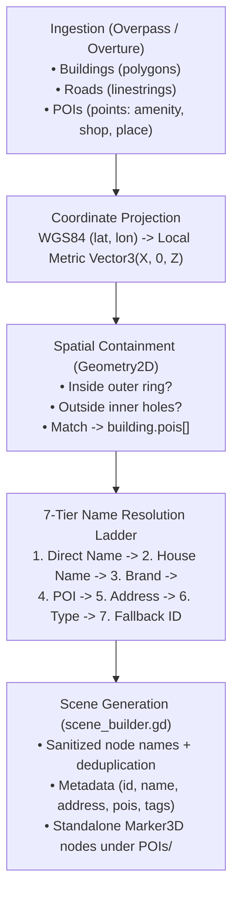

# Building Naming & POI Integration

Architecture, data pipeline, spatial matching algorithms, and fallback resolution rules used to name 3D building models and represent Points of Interest (POIs) in **OSM-to-Godot**.

---

## 1. Problem Statement

Raw map data frequently lacks direct building names:

- **Commercial / Multi-tenant**: Businesses are commonly mapped as standalone point elements (`node` in OSM, `place` in Overture) located _inside_ the building polygon rather than as tags on the building footprint itself.
- **Addressed Properties**: Buildings often carry address tags (`addr:housenumber` + `addr:street`) but no proper name.
- **Ancillary Structures**: Garages and sheds carry only generic classification tags (`building=garage`).

Querying only building tags results in generic fallback names (`Building_29518082`). This system resolves meaningful names by:

1. Ingesting POI points within the bounding box.
2. Spatially assigning POI points to enclosing building footprints via 2D point-in-polygon containment.
3. Applying a deterministic 7-tier priority ladder to resolve the best name.
4. Instantiating standalone 3D POI markers for all points.

---

## 2. Pipeline Flow



---

## 3. Data Ingestion & POI Filtering

### OpenStreetMap (Overpass QL)

Queries nodes with primary POI tags in union with ways:

```overpass
[out:json][timeout:30];
(
  way["highway"]({{bbox}});
  way["building"]({{bbox}});
  relation["building"]({{bbox}});
  node["amenity"]({{bbox}});
  node["shop"]({{bbox}});
  node["tourism"]({{bbox}});
  node["leisure"]({{bbox}});
  node["office"]({{bbox}});
  node["historic"]({{bbox}});
  node["healthcare"]({{bbox}});
  node["craft"]({{bbox}});
);
out body geom;
```

### Overture Maps (GeoJSON / GeoParquet)

Extracts points from the `places` theme (`categories.primary`, `names.primary`, `brand.names.primary`) alongside addresses and building footprints.

---

## 4. Geometric Containment & Spatial Matching

Implemented in `osm_parser.gd` (OSM) and `geojson_parser.gd` (GeoJSON / Overture):

1. **Projection**: Project POI coordinates to horizontal metric coordinates $(X, Z)$ relative to the bounding box centroid.
2. **Exterior Ring Test**: Test $(P_x, P_z)$ against each exterior loop using `Geometry2D.is_point_in_polygon(pt, outer_ring)`.
3. **Interior Hole Exclusion**: If inside an exterior ring, test against inner courtyard holes (`inner_rings`). If inside a hole, exclude the point.
4. **Association**: Points passing both tests are appended to `building.pois`.

---

## 5. Building Name Resolution Ladder

Evaluated in `BuildingBuilder.get_building_display_name(building)`:

|  Tier  | Source                    | Priority Condition                         | Example Output                |
| :----: | :------------------------ | :----------------------------------------- | :---------------------------- |
| **1**  | Direct `name` / `name:en` | Explicit building name tag                 | `"Dunkin'"`                   |
| **2**  | `addr:housename`          | House or estate name                       | `"Rose Cottage"`              |
| **3**  | `brand`                   | Corporate identity                         | `"Target"`                    |
| **4**  | Enclosed POI              | First named POI spatially inside footprint | `"Medford Police Department"` |
| **5a** | Full Street Address       | Both `addr:housenumber` and `addr:street`  | `"9 Emerson Street"`          |
| **5b** | Street Only               | Only `addr:street` present                 | `"Main Street"`               |
| **5c** | House Number Only         | Only `addr:housenumber` present            | `"No. 154"`                   |
| **6**  | Specialized Type          | Non-generic `building` (not `yes`/`roof`)  | `"Garage"`, `"Industrial"`    |
| **7**  | Fallback                  | Unclassified structure                     | `"Building_29535893"`         |

---

## 6. Node Sanitization & Hierarchy Disambiguation

- **Path Delimiter Sanitization**: Replaces `.`, `:`, `@`, `/`, `"`, `%` with underscores (e.g. `Volsar, Inc.` $\to$ `Volsar, Inc_`).
- **Duplicate Disambiguation**: Sibling nodes sharing names are registered via `add_child(node, true)`, triggering Godot's automatic numbering (`Garage`, `Garage2`, `Garage3`) without `@Node@` mangling.

---

## 7. Node Metadata Contract

Each generated building `Node3D` carries runtime metadata:

- `osm_id` (`Variant`): Source element ID.
- `osm_name` (`String`): Resolved human-readable name.
- `osm_address` (`String`): Formatted street address (if available).
- `osm_pois` (`Array[Dictionary]`): Enclosed POI dictionaries with names, categories, and tags.
- `osm_tags` (`Dictionary`): Complete raw source tags dictionary.

Standalone POIs (including outdoor amenities, parks, and monuments) are instantiated under a dedicated `POIs` scene node as lightweight `Marker3D` nodes with identical metadata.
