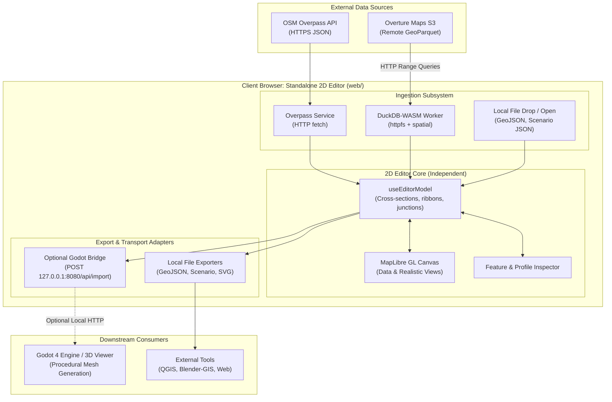

# DuckDB-WASM & Standalone 2D Editor: Architectural Plan

## 1. Executive Summary

This plan addresses two core architectural goals:

1. **In-Browser DuckDB-WASM Ingestion:** Replace host-dependent Python scripts (`scripts/fetch_overture.py`, `uvx overturemaps`) with client-side DuckDB-WASM (`@duckdb/duckdb-wasm`). Query Overture Maps GeoParquet directly from public S3 buckets via HTTP range requests (`httpfs` + `spatial`).
2. **Standalone 2D Editor Decoupling:** Establish the 2D street and map editor as a self-sufficient web application. Godot becomes an optional downstream consumer (via `/api/import`), not a mandatory execution host or server dependency.

---

## 2. Target Architecture



---

## 3. Key Architectural Changes

### 3.1 Eliminating the Python / Host Toolchain Dependency

- **Current:** Browser $\to$ Godot (`http_server.gd`) $\to$ `OS.execute("python3", ...)` $\to$ `uvx overturemaps` $\to$ S3 $\to$ host `duckdb` CLI $\to$ Godot $\to$ Browser.
- **New:** Browser $\to$ `@duckdb/duckdb-wasm` Web Worker $\to$ Overture S3 $\to$ Browser 2D Editor.
- **Benefits:**
  - Eliminates Python, `uv`, and host CLI binaries from user prerequisites.
  - Works on pure static hosting (GitHub Pages, Netlify, Vercel) without any backend server.
  - Direct SQL control over bounding boxes, attribute projections, and feature limits.

### 3.2 Decoupling the 2D Editor from Godot

- The editor functions as a standalone GIS workbench:
  - Open, edit, and inspect street profiles, lane assignments, sidewalks, and building footprints.
  - Save and load local scenarios without Godot running.
  - Detect Godot server presence via non-blocking heartbeat (`/api/status`). If offline, "Send to Godot" is gracefully disabled or tucked into an export panel alongside "Download GeoJSON" and "Export Scenario".

---

## 4. DuckDB-WASM Ingestion Design

### 4.1 Remote GeoParquet Queries

Overture Maps publishes partitioned GeoParquet files to Amazon S3 (`s3://overturemaps-us-west-2/release/`). DuckDB-WASM supports spatial queries over HTTP/HTTPS:

```sql
INSTALL spatial;
LOAD spatial;

-- Query buildings within bounding box using bounding box pushdown
SELECT
    id,
    ST_AsGeoJSON(geometry) AS geometry_geojson,
    height,
    num_floors,
    names.primary AS name
FROM read_parquet('https://overturemaps-us-west-2.s3.amazonaws.com/release/<release-tag>/theme=buildings/type=building/*', hive_partitioning=1)
WHERE bbox.xmin >= $min_lon AND bbox.xmax <= $max_lon
  AND bbox.ymin >= $min_lat AND bbox.ymax <= $max_lat
LIMIT 5000;
```

### 4.2 Web Worker Architecture

- Run DuckDB-WASM inside a dedicated Web Worker to prevent UI thread lockups during Parquet downloads and spatial indexing.
- Return streamed batches directly to the Vue composition layer (`useOvertureWasm.ts`).
- Maintain an in-memory cache and IndexedDB storage for downloaded bounding boxes to avoid redundant S3 bandwidth.

---

## 5. Implementation Phases

### Phase 1: Standalone Editor Boundary & UI Separation

- [ ] Decouple `web/src/components/ExportControls.vue` and `web/src/App.vue` from assuming a Godot-first workflow.
- [ ] Provide explicit standalone actions: **Open File**, **Save Scenario JSON**, **Export GeoJSON**, **Send to 3D View (Godot)**.
- [ ] Make Godot bridge discovery passive and non-blocking (poll status with backoff; display connection chip in status bar).

### Phase 2: DuckDB-WASM Infrastructure in `web/`

- [ ] Add `@duckdb/duckdb-wasm` and `apache-arrow` to `web/package.json`.
- [ ] Configure Vite for WebAssembly worker bundling and cross-origin isolation headers (COOP/COEP where required).
- [ ] Implement `web/src/services/duckdb.ts`:
  - Worker lifecycle management (instantiation, bundle selection: MVP vs. EH/SIMD).
  - Extension initialization (`spatial`, HTTP file access).
  - Parameterized query runner returning GeoJSON feature arrays.

### Phase 3: Client-Side Overture Acquisition

- [ ] Implement `web/src/composables/useOvertureWasm.ts`:
  - Coordinate queries across `buildings`, `transportation` (segments/connectors), and `places`.
  - Progress reporting: bytes transferred, features parsed, query timing.
  - Convert Arrow table outputs to the project's standard GeoJSON `FeatureCollection` format.
- [ ] Wire acquisition directly into the 2D Editor model (`useEditorModel.ts`).
- [ ] Deprecate `scripts/fetch_overture.py` and remove Python subprocess calls from `godot_project/addons/osm_importer/http_server.gd`.

### Phase 4: Standalone Packaging & Tooling (Optional Expansion)

- [ ] Support Progressive Web App (PWA) manifest and offline service worker for cached tile/scenario editing.
- [ ] Evaluate native desktop packaging (Go Wails or Rust Tauri) **only if** filesystem access or native OS windowing is required beyond what the standalone web app provides.

---

## 6. Risks & Mitigations

| Risk                         | Impact                                                                | Mitigation                                                                                                                                                                                                    |
| :--------------------------- | :-------------------------------------------------------------------- | :------------------------------------------------------------------------------------------------------------------------------------------------------------------------------------------------------------ |
| **S3 CORS / Range Requests** | Overture S3 bucket might restrict direct browser range requests.      | Overture's public S3 buckets currently permit anonymous GET and HEAD with CORS. Verify range request compatibility early in Phase 2. Fall back to Cloudflare R2 mirror or lightweight CORS proxy if required. |
| **WASM Memory Limits**       | Large bounding boxes (>50k buildings) may exhaust browser tab memory. | Enforce bbox size constraints in the UI before query execution; stream batches using Arrow record batches instead of materializing full GeoJSON strings.                                                      |
| **Initial WASM Bundle Size** | DuckDB-WASM + Spatial extension adds ~15–20MB download on first load. | Lazy-load the DuckDB worker only when the user selects the Overture layer or initiates an Overture query. Keep standard Overpass (OSM) instant and zero-overhead.                                             |
