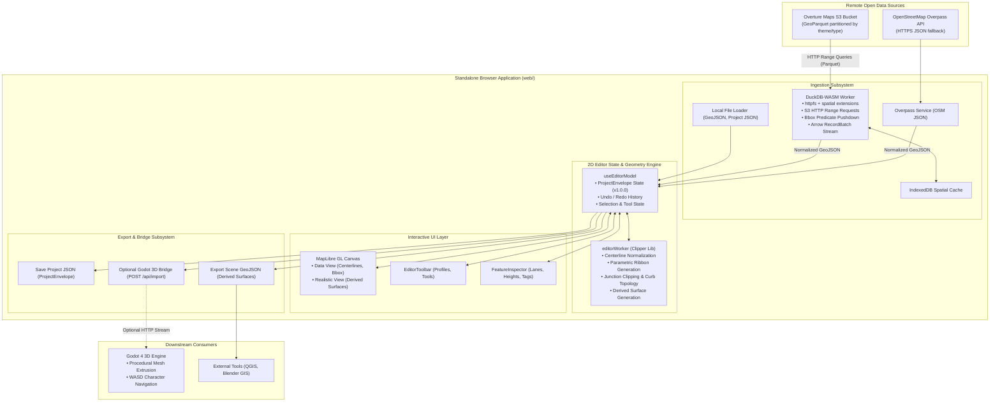
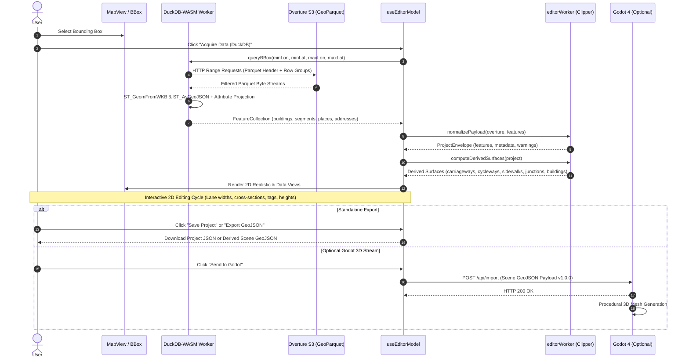

# DuckDB-WASM & Standalone 2D Editor Architecture

Architecture specification for evolving the web application into an autonomous, browser-native 2D Urban Geometry Studio using client-side DuckDB-WASM for Overture Maps GeoParquet ingestion, with Godot 4 as an optional downstream consumer.

---

## 1. System Vision

- **Client-Side DuckDB-WASM Ingestion**: Execute spatial SQL queries directly within a Web Worker via `@duckdb/duckdb-wasm`. Queries read Overture Maps GeoParquet on Amazon S3 via HTTP range requests (`httpfs` + `spatial`), downloading only row groups matching the selected bounding box via Parquet metadata predicate pushdown.
- **Autonomous 2D Editor**: A standalone web GIS tool for selecting areas, editing road cross-sections, lane layouts, and building footprints, and saving/exporting results (`ProjectEnvelope` JSON and derived surface GeoJSON).
- **Decoupled Downstream Bridge**: Godot 4 is an optional procedural 3D viewer consuming derived surfaces via `POST 127.0.0.1:8080/api/import` or file drag-and-drop. Godot is not required for data acquisition or 2D editing.

---

## 2. Target Architecture



---

## 3. Lifecycle Sequence



---

## 4. DuckDB-WASM Ingestion Design

### 4.1 Remote GeoParquet Storage

- **S3 Bucket**: `s3://overturemaps-us-west-2/release/`
- **HTTPS Public Base**: `https://overturemaps-us-west-2.s3.amazonaws.com/release/`
- **Partitions**:
  - Buildings: `theme=buildings/type=building/*`
  - Transportation Segments: `theme=transportation/type=segment/*`
  - Places (POIs): `theme=places/type=place/*`
  - Addresses: `theme=addresses/type=address/*`

### 4.2 Predicate Pushdown via HTTP Range Requests

DuckDB-WASM's Parquet reader reads the footer and column statistics via small HTTP range requests. When filtering by `bbox.xmin`, `bbox.xmax`, `bbox.ymin`, and `bbox.ymax`:

- Only matching row groups are transferred.
- For typical city blocks (0.1 to 2.0 km²), total network transfer is **1–8 MB**.

### 4.3 Web Worker Layout (`web/src/services/duckdb/`)

- `duckdbWorker.ts`: Instantiates DuckDB-WASM inside a dedicated Web Worker using the non-threaded exception-handling bundle (`duckdb-eh.wasm`) to run without COOP/COEP header requirements on static hosts.
- `duckdbWorkerBridge.ts`: Main-thread typed Promise RPC bridge (`queryOvertureBBox`).
- `queries.ts`: Parameterized SQL statements with bounding-box pushdown.
- `cache.ts`: IndexedDB spatial cache keyed by quantized bounding box.

### 4.4 Parameterized Query Templates

```sql
-- 1. Buildings Theme
INSTALL spatial;
LOAD spatial;

SELECT
    id,
    ST_AsGeoJSON(geometry) AS geometry,
    height,
    num_floors,
    level,
    class,
    names.primary AS name,
    sources[1].dataset AS source_dataset
FROM read_parquet(
    'https://overturemaps-us-west-2.s3.amazonaws.com/release/2024-11-13.0/theme=buildings/type=building/*',
    hive_partitioning=1
)
WHERE bbox.xmin <= $max_lon AND bbox.xmax >= $min_lon
  AND bbox.ymin <= $max_lat AND bbox.ymax >= $min_lat
LIMIT $limit_buildings;

-- 2. Transportation Segments Theme
SELECT
    id,
    ST_AsGeoJSON(geometry) AS geometry,
    subtype,
    class,
    subclass,
    names.primary AS name,
    level,
    access_restrictions,
    speed_limits,
    sources[1].dataset AS source_dataset
FROM read_parquet(
    'https://overturemaps-us-west-2.s3.amazonaws.com/release/2024-11-13.0/theme=transportation/type=segment/*',
    hive_partitioning=1
)
WHERE bbox.xmin <= $max_lon AND bbox.xmax >= $min_lon
  AND bbox.ymin <= $max_lat AND bbox.ymax >= $min_lat
LIMIT $limit_segments;

-- 3. Places (POIs) Theme
SELECT
    id,
    ST_AsGeoJSON(geometry) AS geometry,
    names.primary AS name,
    categories.primary AS category,
    brand.names.primary AS brand_name
FROM read_parquet(
    'https://overturemaps-us-west-2.s3.amazonaws.com/release/2024-11-13.0/theme=places/type=place/*',
    hive_partitioning=1
)
WHERE bbox.xmin <= $max_lon AND bbox.xmax >= $min_lon
  AND bbox.ymin <= $max_lat AND bbox.ymax >= $min_lat
LIMIT 1000;
```

---

## 5. Technical Risks & Mitigations

| Risk                           | Impact                                                      | Mitigation                                                                                                  |
| :----------------------------- | :---------------------------------------------------------- | :---------------------------------------------------------------------------------------------------------- |
| **S3 CORS & Range Requests**   | S3 bucket rejects browser range headers                     | Overture's S3 bucket has public CORS enabled (`GET`, `HEAD`, `Range`). Compatible with DuckDB-WASM HTTPFS.  |
| **WASM Memory Ceiling**        | Large bounding boxes trigger OOM in 32-bit WASM             | Enforce area limits in UI (`useBBox.ts`). Stream Arrow record batches; project only needed columns in SQL.  |
| **Initial WASM Download Size** | DuckDB-WASM + Spatial is ~15–20 MB                          | Code-split and lazy-load the DuckDB worker chunk only upon first Overture acquisition request.              |
| **COOP/COEP Headers**          | Multi-threaded WASM requires cross-origin isolation headers | Use non-threaded bundle (`duckdb-eh.wasm`), enabling deployment on any static host without special headers. |
| **Overture Schema Evolution**  | Monthly release tag changes                                 | Store release tag as configurable constant with version discovery fallback.                                 |

---

## 6. Canonical Data Schemas

| Schema                      | Producer                       | Consumer                   | Format                    |
| :-------------------------- | :----------------------------- | :------------------------- | :------------------------ |
| **Overture GeoParquet**     | Overture Maps Foundation (S3)  | `duckdbWorker.ts`          | Remote GeoParquet         |
| **Raw Normalized Features** | `duckdbWorker` / `useOverpass` | `normalization.ts`         | GeoJSON FeatureCollection |
| **ProjectEnvelope**         | `useEditorModel`               | Save Project (.json)       | Custom v1.0.0 JSON        |
| **Derived Surfaces**        | `viewSurfaces.ts` / Clipper    | Export Scene (.geojson)    | 2D Polygon GeoJSON        |
| **Editor Scene Payload**    | `exportEditorGodotPayload.ts`  | Godot (`POST /api/import`) | Scene Payload v1.0.0      |

_Task tracking and implementation phases are managed in [`todo/duckdb_wasm_standalone_editor.md`](../todo/duckdb_wasm_standalone_editor.md)._
