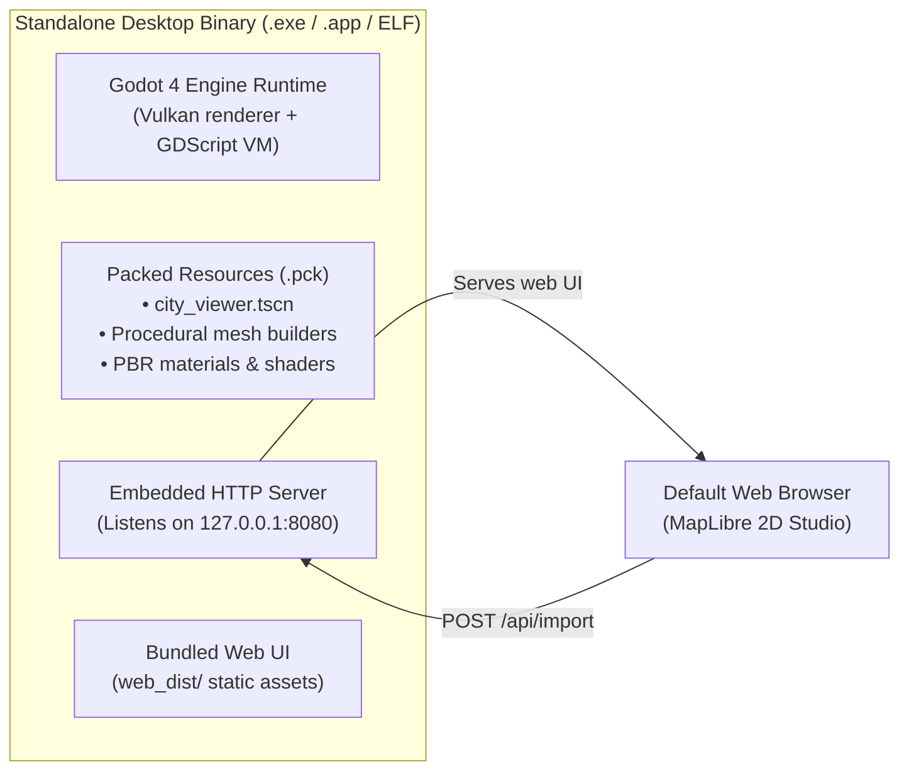

# Standalone Desktop Distribution Guide

Architecture and instructions for packaging **OSM-to-Godot** as a standalone, turnkey desktop application bundling the Godot runtime.

---

## 1. Concept & Architecture

Bundling packages the Godot runtime, procedural geometry scripts, PBR materials, and pre-compiled web assets into a single executable:



### End-User Experience

- No game engine, Bun, Node.js, or Python installation required.
- Double-clicking the application launches the 3D viewer and opens the browser map studio automatically.
- Clicking **⚡ Send to Godot** in the browser immediately generates 3D geometry in the native window.

---

## 2. Enabling Standalone Execution

### Step 1: Attach Runtime Server Controller to `city_viewer.tscn`

Attach a script to the root `CityRoot` node in `city_viewer.tscn`:

```gdscript
extends Node3D

const OSMHttpServerClass = preload("res://addons/osm_importer/http_server.gd")
const OSMSceneBuilderClass = preload("res://addons/osm_importer/scene_builder.gd")

var http_server: OSMHttpServer
@onready var streets_container: Node3D = $Streets
@onready var buildings_container: Node3D = $Buildings

func _ready() -> void:
    http_server = OSMHttpServerClass.new(8080)
    http_server.import_received.connect(_on_import_received)
    var err = http_server.start(8080)
    if err == OK:
        print("[OSM Tool] Server listening: ", http_server.get_url())
        OS.shell_open(http_server.get_url())
    else:
        push_error("[OSM Tool] Failed to bind port 8080: " + str(err))

func _process(_delta: float) -> void:
    if http_server:
        http_server.poll()

func _exit_tree() -> void:
    if http_server:
        http_server.stop()
        http_server = null

func _on_import_received(parsed_data: Dictionary, _raw_payload: Dictionary) -> void:
    for child in buildings_container.get_children():
        child.queue_free()
    for child in streets_container.get_children():
        child.queue_free()

    var buildings = parsed_data.get("buildings", [])
    var roads = parsed_data.get("roads", [])
    OSMSceneBuilderClass.populate_city_node(self, buildings, roads)
```

### Step 2: Set Main Scene in `project.godot`

```ini
[application]
config/name="OSM 3D City Explorer"
run/main_scene="res://city_viewer.tscn"
```

### Step 3: Configure Export Filters

Because Godot exports only known engine resource types by default, non-resource web assets must be explicitly included in **Project → Export → Resources → Filters to export non-resource files/folders**:

```text
addons/osm_importer/web_dist/*, *.html, *.js, *.css, *.mjs, *.svg
```

---

## 3. Build & Release Commands

Ensure frontend assets are compiled into `godot_project/addons/osm_importer/web_dist/` first:

```bash
mise run build-web
```

Export standalone platform binaries (requires Godot export templates installed):

```bash
# Windows
godot --headless --path godot_project --export-release "Windows Desktop" builds/windows/OSMCityExplorer.exe

# macOS
godot --headless --path godot_project --export-release "macOS" builds/macos/OSMCityExplorer.dmg

# Linux
godot --headless --path godot_project --export-release "Linux/X11" builds/linux/OSMCityExplorer.x86_64
```
